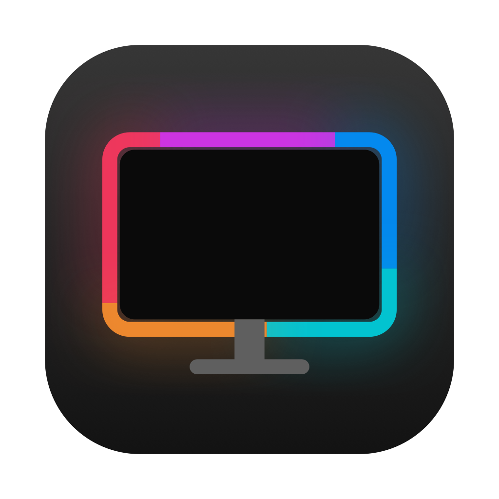
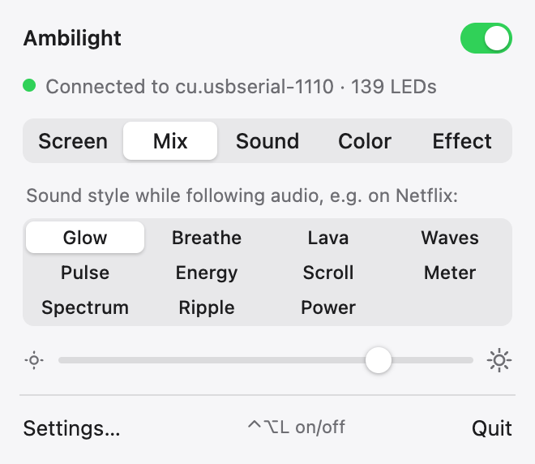
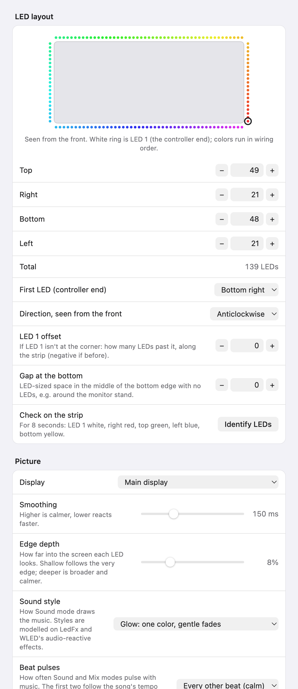

<p align="center">
  
</p>

<h1 align="center">Ambilight</h1>

<p align="center">
  <b>Screen-synced LED lighting for your monitor.</b><br>
  A tiny, open-source menu bar app for macOS and Windows that mirrors your screen, music and movies onto the LED strip behind your display.
</p>

<p align="center">
  <a href="https://github.com/ThePubDoc/ambilight/releases/latest"></a>
  <a href="https://github.com/ThePubDoc/ambilight/releases"></a>
  <a href="https://github.com/ThePubDoc/ambilight/actions/workflows/ci.yml"></a>
  
  <a href="LICENSE"></a>
</p>

<p align="center">
  <a href="https://github.com/ThePubDoc/ambilight/releases/latest"><b>Download for macOS or Windows</b></a>
  &nbsp;·&nbsp; <a href="#quick-start">Quick start</a>
  &nbsp;·&nbsp; <a href="#faq">FAQ</a>
</p>

<!-- DEMO: a 15–30 s video of the strip following a movie scene and pulsing to music goes here.
     To add it, edit this file on github.com and drag the .mp4 into the editor; GitHub turns it into an embedded player. -->

<p align="center">
  <picture>
    <source media="(prefers-color-scheme: dark)" srcset="docs/popover-dark.png">
    
  </picture>
</p>

## Why Ambilight

- **Native and tiny.** A menu bar / tray app: a 5 MB download, about 10 MB installed. No web UI, no local server, no Raspberry Pi.
- **Set up in minutes.** Count your LEDs per side, pick the corner the strip starts at, and check it with **Identify LEDs**. A live preview shows exactly where each LED looks.
- **Follows music, not just the screen.** Eleven [sound styles](#sound-styles), from calm fades and slow waves to beat ripples and spectrum bars, plus **Mix** mode, which combines the screen's colors with the beat for games and music videos.
- **Works alongside Netflix.** Streaming sites black out video while the screen is captured. Ambilight notices Netflix, Prime Video, Disney+ and others, and follows the soundtrack instead, so the video keeps playing.
- **Uses the hardware you have.** Any Adalight USB controller (Arduino, ESP8266/ESP32), or a WLED controller over Wi-Fi.

<details>
<summary><b>All features</b></summary>

- **Lives in the menu bar / system tray.** One click opens a small panel: on/off, mode, brightness. No browser, no local web server.
- **Five modes.** **Screen** follows what's on the display. **Mix** uses the screen's colors but pulses with the audio, which is great for games and music videos. **Sound** follows the music or movie you're playing, in one of eleven [styles](#sound-styles): calm ones (Glow, Breathe, Lava, Waves) and lively ones (Pulse, Energy, Scroll, Meter, Spectrum, Ripple, Power). **Color** holds one color (ten presets or any custom color). **Effect** plays an animation: Rainbow, Spectrum (bass glows along the bottom, treble across the top), Breathing, Candle or Aurora.
- **Works with Netflix and other streaming.** Streaming sites black out their video while the screen is captured, so when a Netflix, Prime Video, Disney+ (and others) window is in front, Ambilight switches to Sound mode by itself: the video stays visible and the lights follow the soundtrack. YouTube and everything else keep screen sync. See [Streaming video](#streaming-video).
- **Fits any strip layout.** Set LEDs per side, which corner the strip starts at and which way it runs. A live preview shows the result, and **Identify LEDs** lights each side in its own color so you can check it on the real strip.
- **Ignores black bars.** Letterboxed and pillarboxed videos use the picture area, not the bars.
- **Looks right on cheap strips.** White balance sliders fix a blue or green tint, and the edge depth slider sets how far into the picture each LED looks.
- **Protects your power supply.** Enter the adapter's rating and bright scenes are dimmed just enough to stay under 90% of it.
- **Keyboard shortcuts** work in any app: ⌃⌥L / Ctrl+Alt+L toggles the lights, ⌃⌥M / Ctrl+Alt+M cycles modes, ⌃⌥↑↓ / Ctrl+Alt+↑↓ changes brightness.
- **App profiles.** Use a different mode while a particular app is in front, e.g. Mix for games or Sound for a music player.
- **Night schedule.** Turn the lights off or dim them every night between two times.
- **USB or Wi-Fi.** Drives an Adalight controller over USB, or a [WLED](https://kno.wled.ge) controller over the network.
- **Multiple displays.** Pick which monitor to follow.
- **Updates itself.** Checks GitHub for new releases and installs them in one click.
- **Recovers by itself.** Reconnects when the USB cable is unplugged and plugged back in, restarts capture after the computer sleeps, and turns the strip off when the app quits (and, on macOS, while the display sleeps).
- **Small and light.** A 5 MB download. The screen is captured at low resolution (about 320 px wide on macOS, a GPU-downscaled frame on Windows), so it barely uses the CPU.

</details>

## Quick start

1. **Download** the latest release for [macOS or Windows](https://github.com/ThePubDoc/ambilight/releases/latest) and install it (first launch on macOS: right-click → **Open**; see [Install](#install)).
2. **Plug in** your controller and power the strip. Ambilight finds the USB port by itself.
3. **Open Settings…** from the panel, enter your LEDs per side, the corner where LED 1 sits and the direction, set the speed to your firmware's baud rate, and click **Identify LEDs** to check.

That's it. Pick a mode in the panel; the rest of this page covers the details.

## How it compares

[Hyperion.ng](https://github.com/hyperion-project/hyperion.ng) is the established open-source ambilight and does far more: Raspberry Pi installs, HDMI/USB video grabbers, dozens of LED device types, a JSON API and Home Assistant integration. Ambilight is for the common desktop case: one strip behind one computer monitor.

| | Ambilight | Hyperion.ng |
|---|---|---|
| Setup and controls | Menu bar / tray panel and a settings window | Web interface in the browser |
| App size (macOS) | ~10 MB installed | ~85 MB installed |
| Music | Beat tracking, Sound and Mix modes | Audio effects (via audio grabber) |
| Netflix and other DRM video | Switches to the soundtrack automatically | Video goes black while the screen is captured (as with any screen capture) |
| LED hardware | Adalight (USB), WLED (Wi-Fi) | Many devices and protocols |
| Runs on | macOS 14.2+, Windows 10/11 | Linux, Raspberry Pi, macOS, Windows |
| HDMI capture devices | No | Yes |

If you need a Raspberry Pi setup, a TV with an HDMI grabber, or exotic LED hardware, use Hyperion. If you want a strip behind your computer monitor that just works, try Ambilight.

## FAQ

**Why does Netflix go black with other ambilight apps, and how does Ambilight avoid it?**
Netflix, Prime Video, Disney+ and others protect their video: while any app captures the screen, the browser shows black. Nothing can legitimately read that picture, so Ambilight detects these services from the window title and stops capturing while one is in front, following the soundtrack instead. See [Streaming video](#streaming-video).

**Does it record my screen or audio?**
No. The screen is read at about 320 px wide and reduced to one color per LED; the audio is reduced to loudness levels. Nothing is stored or sent anywhere. The only network traffic is to your WLED controller (if you use one) and checking GitHub for updates, which you can turn off.

**How much CPU does it use?**
Very little: the screen is captured at low resolution (on Windows, the GPU shrinks each frame before the CPU sees it), and the LED loop runs at 50 frames per second.

**Which LED strips and controllers work?**
Individually addressable strips (WS2812B, SK6812 and similar) driven by an Adalight-compatible USB controller or by WLED over Wi-Fi. See [What you need](#what-you-need).

**Does it work with Philips Hue, Govee or Nanoleaf?**
Not yet. Ambilight drives LED strips through Adalight or WLED.

**Linux?**
Not yet. Most of the code is cross-platform; Linux needs screen and audio capture backends (PipeWire). Contributions welcome.

**Why does macOS say the app is from an unidentified developer?**
The app isn't notarized by Apple, which needs a paid developer account. It's built from this repository by [GitHub Actions](.github/workflows/release.yml); you can also [build it yourself](#build-from-source).

## What you need

- **An LED strip** with individually addressable LEDs (WS2812B, SK6812 and similar), stuck around the back of the screen.
- **A controller**, either:
  - **USB with Adalight firmware**: any board and sketch that speaks the Adalight serial protocol (`Ada` header, then RGB bytes). An Arduino Nano or ESP8266/ESP32 with a FastLED-based Adalight sketch is the usual choice. Set the sketch's LED count and baud rate to match your strip, and use the same baud rate in Ambilight.
  - **Wi-Fi with [WLED](https://kno.wled.ge)** on an ESP32/ESP8266. Set its LED count to match your layout, then choose **Wi-Fi (WLED)** under **Settings → Connection** and enter its IP address or name. Ambilight uses WLED's realtime UDP protocol (port 21324), so no extra setup is needed in WLED.
- **A separate 5 V power supply for the strip.** USB can't power more than a handful of LEDs. Budget up to 60 mA per LED at full white (139 LEDs ≈ 8 A), less if you keep brightness lower. Connect the supply's ground to the controller's ground.

Wiring: controller data pin → strip **DIN** (the end where the printed arrows point away from), 5 V and GND from the power supply to the strip, and a shared ground between supply and controller.

## Install

Download the latest installer from [Releases](https://github.com/ThePubDoc/ambilight/releases):

- **macOS 14.2 or later**: `Ambilight_<version>_aarch64.dmg` for Apple silicon, `Ambilight_<version>_x64.dmg` for Intel Macs. Open the DMG and drag Ambilight to Applications.
- **Windows 10/11**: `Ambilight_<version>_x64-setup.exe`.

### First launch on macOS

The app isn't notarized by Apple, so:

1. **Open it:** the first time, right-click Ambilight in Applications and choose **Open**, then **Open** again. If macOS refuses, go to **System Settings → Privacy & Security** and click **Open Anyway**.
2. **Allow screen recording:** open **System Settings → Privacy & Security → Screen & System Audio Recording**. If Ambilight is listed, switch it on. If it isn't (common for apps without an Apple Developer ID), click **+** and add it from Applications. Ambilight notices within a few seconds; no restart needed.
3. **For Sound mode, allow system audio:** the first time Sound mode runs, macOS asks whether Ambilight may record system audio; click **Allow**. If you missed it, the same settings page has a **System Audio Recording Only** list where you can switch Ambilight on (or add it with **+**). Ambilight only measures how loud the audio is; it never records or stores it, and it doesn't use the microphone.

Permissions carry over when you update: from 0.2.3 on, every release is signed with the same certificate, and macOS ties these permissions to the app's signature. If you're updating from 0.2.2 or earlier, macOS asks once more. If the switch already looks on but Ambilight still asks, select Ambilight in the list, remove it with **−**, then add it again with **+**.

### First launch on Windows

Windows SmartScreen may warn about an unknown publisher: click **More info → Run anyway**. Most controllers use a CH340 or CP210x USB chip. Windows usually installs the driver automatically; if the controller doesn't show up, install the driver from the chip maker.

> Windows support is new and hasn't been tested with real hardware yet. Reports are very welcome.

## Set up your strip

<p align="center">
  <picture>
    <source media="(prefers-color-scheme: dark)" srcset="docs/settings-dark.png">
    
  </picture>
</p>

1. Plug in the controller and power the strip. With **Port** set to **Automatic**, Ambilight connects when exactly one USB serial device with a common LED-controller chip (CH340, CP210x, FTDI, Arduino, Espressif) is plugged in. If you also have a 3D printer, dev board or similar connected, choose the controller under **Settings → Connection → Port**, so the LED data never goes to the wrong device.
2. Open **Settings…** from the panel (or right-click the tray icon).
3. Under **Connection**, set **Speed** to your firmware's baud rate.
4. Under **LED layout**, enter the LED count for each side, the corner where LED 1 sits (the end wired to the controller), and the direction the strip runs, seen from the front of the screen.
5. Click **Identify LEDs**. For 8 seconds LED 1 lights white, the right side red, the top green, the left side blue and the bottom yellow. If a color appears on the wrong side, adjust the corner or direction. If LED 1 isn't at a corner, set **LED 1 offset**; if the bottom edge has no LEDs around the monitor stand, set **Gap at the bottom**.
6. Optional but recommended: under **White balance**, click **Show white** and lower any color that makes white look tinted; under **Power**, enter your adapter's amps.

Settings are saved as JSON in `~/Library/Application Support/com.thepubdoc.ambilight/` on macOS and `%APPDATA%\com.thepubdoc.ambilight\` on Windows.

## Streaming video

Netflix, Prime Video, Disney+ and other streaming services protect their video: while any app captures the screen, the browser shows black instead. No screen-capture ambilight can read that picture, so Ambilight steps aside instead.

It recognises the service from the title of the window in front (browsers title their windows after the active tab, e.g. "Netflix" or "… | Prime Video"). While such a window is in front, Ambilight stops capturing the screen, so the video plays normally, and shows **Sound** mode instead: the lights follow the soundtrack, pulsing with music and flashing on loud moments. Switch to another tab or app and screen sync resumes within half a second. This works in any browser and in the services' own apps.

In **Settings → Streaming video** you can choose another fallback (**Color** or **Effect**) and turn individual services off. This applies to both Screen and Mix modes. Supported: Netflix, Prime Video, Disney+, JioHotstar/JioCinema, Apple TV+, Hulu, Paramount+, Peacock, SonyLIV, ZEE5 and Crunchyroll.

Sound mode also works on its own: pick **Sound** in the panel to make the strip follow music.

## Music

**Sound** and **Mix** modes follow the song's tempo: after a few seconds of music they pulse on the beat and ignore sounds between beats, like vocals and guitars. Between beats the strip glows with the music's loudness, and its color follows the sound: warm for bass-heavy music, cool for bright music. Choose how often it pulses under **Settings → Picture → Beat pulses**:

- **Every other beat (calm)**, the default: one pulse per kick on most pop and dance music. Songs slower than 100 BPM pulse on every beat.
- **Every beat**.
- **Every drum hit**: no tempo tracking, pulses on every kick and snare.

Music without a clear beat (ambient, speech) just glows.

### Sound styles

In **Sound** mode, and in **Mix** for when it follows the soundtrack of a streaming service, the panel shows how to draw the music (also under **Settings → Picture → Sound style**). The calm styles never flash and stay below 60% brightness; the lively ones react to every beat and note. They are modelled on well-known audio-reactive effects from [LedFx](https://docs.ledfx.app) and [WLED's sound-reactive fork](https://mm.kno.wled.ge/WLEDSR/Reactive-Animations/):

| Style | What it does | Inspired by |
|---|---|---|
| **Glow** (default, calm) | One color that fades gently with the loudness and the music's character, no beat flashes | Philips Hue Sync "Subtle" |
| **Breathe** (calm) | The strip slowly breathes in and out at the song's tempo, once every two bars | |
| **Lava** (calm) | Soft blobs of neighbouring colors drift slowly around the screen | LedFx Lava lamp, WLED Midnoise |
| **Waves** (calm) | Slow waves roll up from the bottom, swelling with the loudness | WLED Plasmoid |
| **Pulse** | One color that follows the loudness, with soft pulses on beats | |
| **Energy** | Bass, mids and treble as red, green and blue bars growing from the bottom center | LedFx Energy |
| **Scroll** | The sound's color enters at the bottom and flows up both sides | LedFx Scroll, WLED Waterfall |
| **Meter** | A volume meter up both sides, green to red, with a falling peak dot | WLED Gravimeter |
| **Spectrum** | Eight frequency bands from bass at the bottom to treble at the top | WLED GEQ, LedFx Bands |
| **Ripple** | Each beat drops a ripple of a new color that spreads and fades | WLED Ripple Peak |
| **Power** | A gradient that swells with the bass, with white sparks on hi-hats and cymbals | LedFx Power |

Positions follow the screen, not the wiring, so every style looks the same whichever corner your strip starts in. Ripple and Pulse use the **Beat pulses** setting above.

## App profiles

Under **Settings → App profiles**, pick a running app and the mode to use while it's in front: any mode, or a specific effect. For example:

- a game → **Mix**, so the screen's colors pulse with the soundtrack;
- Spotify or YT Music → **Sound**;
- a video-call app → **Color** in a soft warm white.

Switch to the app and the mode changes within half a second; switch away and your normal mode returns. The popover shows which profile is active. The streaming switch still applies on top: a browser profile set to Screen or Mix steps aside for Netflix and friends.

## Troubleshooting

| Symptom | Likely cause |
|---|---|
| Status says **USB port is in use by another app** | Another LED app (Hyperion, Prismatik…) has the port. Quit it. |
| Status says **LED controller not found** | Check the USB cable, or pick the port manually under **Connection**. On Windows, check the USB driver. |
| Connected, but the strip stays dark | The strip's 5 V supply is unplugged or switched off, or the data wire is on the wrong end of the strip. |
| Only part of the strip lights | The LED counts add up to fewer LEDs than the strip (or the firmware) has. |
| Colors flicker or look random | Baud rate doesn't match the firmware, or the controller and supply don't share a ground. |
| Wrong colors (red shows as green…) | The firmware's color order doesn't match the strip. Fix it in the firmware sketch (e.g. `GRB` for WS2812B). |
| macOS: stuck on **Needs Screen Recording permission** | Add Ambilight with **+** in Screen & System Audio Recording (see above). |
| Netflix (or another streaming site) goes black | Check the service is switched on under **Settings → Streaming video**. If its tab title doesn't contain the service's name, the window can't be recognised; please open an issue with the title. |
| Sound mode only shows a dim glow | Nothing is playing, or (macOS) Ambilight isn't allowed under **System Audio Recording Only**. The first few seconds of a song just glow while the tempo is found. |
| Music pulses too often, or not often enough | Change **Settings → Picture → Beat pulses**. |
| Bright scenes look dimmer than expected | The **Power** limit is doing its job. Raise it only if your adapter is rated higher. |
| Shortcuts don't work | Another app already uses the same keys, or they're switched off under **Settings → Keyboard shortcuts**. |
| WLED: connected but nothing changes | Check the address, and that WLED's LED count matches the layout. WLED returns to its own effect 2 seconds after Ambilight stops sending. |

Logs are written to `~/Library/Logs/com.thepubdoc.ambilight/ambilight.log` on macOS and `%LOCALAPPDATA%\com.thepubdoc.ambilight\logs\ambilight.log` on Windows. Please attach the log when you open an issue.

## Build from source

You need [Rust](https://rustup.rs) and Node.js 18 or later, plus:

- **macOS:** Xcode or the Command Line Tools (`xcode-select --install`).
- **Windows:** [Visual Studio Build Tools](https://visualstudio.microsoft.com/visual-cpp-build-tools/) with the C++ workload. WebView2 ships with Windows 10/11.

```sh
npm install
npm run dev     # run a development build
npm run build   # installers in target/release/bundle/
cargo test -p ambilight-core
```

**macOS tip:** builds are ad-hoc signed, so macOS treats every rebuild as a new app and forgets the screen recording permission. Run `tools/setup-signing.sh` once to create a local self-signed certificate (in its own keychain, with a random password kept in your login keychain), then `tools/sign-macos.sh` after each `npm run build`. The permission then survives rebuilds. If you set it up before 0.2.3, run `tools/setup-signing.sh` again: older versions used a fixed, published password, so it creates a new identity (macOS asks for the permissions once more). `--rotate` replaces an identity at any time.

### Project layout

```
core/            Platform-independent engine (Rust library, unit-tested)
  src/layout.rs    LED positions from per-side counts, start corner and direction
  src/frame.rs     Edge sampling and black-bar detection
  src/pixels.rs    Gamma, brightness, white balance and the power limiter
  src/adalight.rs  Adalight protocol framing
  src/output.rs    USB (Adalight) and Wi-Fi (WLED UDP) outputs
  src/serial.rs    USB serial port discovery and opening
  src/effects.rs   Rainbow, Spectrum, Breathing, Candle and Aurora
  src/engine.rs    50 Hz loop: capture → smoothing → output; reconnects, sleep, schedule, auto-switch
  src/capture/     Screen capture: ScreenCaptureKit (macOS), DXGI Desktop Duplication (Windows)
  src/audio/       System-audio loudness: Core Audio process tap (macOS), WASAPI loopback (Windows)
  src/sound.rs     Sound and Mix analysis: beat tracking, loudness glow, color
  src/sound_profiles.rs  Sound styles: calm (Glow, Breathe, Lava, Waves) and lively (Pulse, Energy, …)
  src/foreground.rs  Front app and window title: app profiles and the streaming switch
src-tauri/       Desktop app: tray icon, windows, settings storage, start at login, shortcuts, updater
ui/              Popover and settings pages (plain HTML/CSS/JS, no build step)
tools/           Icon generation, README screenshots and local macOS signing helpers
docs/            Screenshots and the social preview card (regenerate with tools/screenshots/capture.sh)
```

### Releasing

Bump the version in `Cargo.toml`, `package.json` and `src-tauri/tauri.conf.json`, then push a tag like `v0.2.0`. The release workflow builds the macOS (Apple silicon and Intel) and Windows installers, plus signed update archives and `latest.json` for the in-app updater, and attaches them to a draft GitHub release. Publish the draft to ship it.

The updater archives are signed with the key in the `TAURI_SIGNING_PRIVATE_KEY` secret; its public half is in `tauri.conf.json`, and the app only installs updates whose signature also covers their version (`requireSignedVersion`). Forks that publish their own builds need their own key (`npx tauri signer generate`).

The macOS app is signed with a self-signed certificate from the `MACOS_SIGNING_P12` secret (a base64 `.p12`) and `MACOS_SIGNING_P12_PASSWORD`, so its signature stays the same from release to release and Screen Recording and System Audio permissions survive updates. It's the maintainer's local identity: `tools/setup-signing.sh --export DIR` writes the `.p12` and its password once, for uploading (delete them afterwards). It isn't an Apple Developer ID, so it doesn't replace notarization.

All three secrets live in the repository's `release` environment, which only `v*` tags may use, so no other workflow or branch can read them. The release job deletes its temporary keychain when it finishes.

Treat that key like a password: an app signed with it as `com.thepubdoc.ambilight` would inherit the permissions users gave Ambilight. That's why the release workflow pins its third-party actions to commit hashes, and why the app uses the hardened runtime (no code can be injected into it to borrow those permissions). If the key may have leaked, run `tools/setup-signing.sh --rotate --export DIR`, update both secrets and release; users then grant the permissions once more.

## Contributing

Bug reports, hardware reports ("works with my strip/controller") and pull requests are very welcome. See [CONTRIBUTING.md](CONTRIBUTING.md) and the issues labelled [good first issue](https://github.com/ThePubDoc/ambilight/labels/good%20first%20issue).

## License

[MIT](LICENSE) © 2026 Aayush Agrawal
